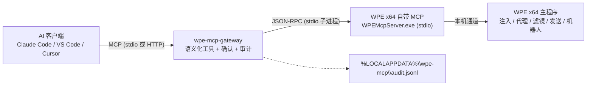

# wpe-mcp-gateway

把 **WPE x64** 的封包能力包装成一层"给 AI 用"的 MCP 服务：语义化的工具、必须的二次确认、可审计的操作记录，以及一个本地协议分析器。

> WPE x64 从 2.3 起**已经自带 MCP 服务**（`C:\WPE64DB\McpServer\WPEMcpServer.exe`，stdio，约 147 个底层工具）。
> 本项目不是重复造轮子，而是在它外面加一层网关，解决三个实际问题，详见下一节。

---

## 为什么要这一层

| 痛点 | WPE 自带 MCP | 本项目 |
|---|---|---|
| 工具数量 | 147 个，AI 容易挑错、参数名对不上 | 收敛成 19 个语义化工具，内部自动匹配上游真实工具名 |
| 安全 | AI 一句"发包"就真的发出去 | 变更类操作先返回**预览 + 令牌**，第二次带令牌才执行；另有速率/间隔上限 |
| 传输 | 只有 stdio，只能本机单客户端 | 额外提供 **HTTP** 模式（带令牌鉴权），可给远程/多客户端用 |
| 复盘 | 没有操作记录 | 每次改包/发包/注入写一条 **JSONL 审计**，随时回查 |
| 协议分析 | 只给十六进制 | `decode_payload` 做异或爆破/Base64/文本预览，`frame_analyze` 猜长度字段与帧步长 |

一句话：**让 AI 少犯错、让操作留痕、让协议分析少往返。**

---

## 架构



网关是**子进程方式**驱动上游连接器，不读写 WPE 的数据库，也不碰浏览器/系统凭据。

---

## 快速开始

前置：Windows 10/11 x64、Python 3.11+、WPE x64 **2.3+**（并已启动过一次）。

```powershell
git clone <本仓库地址> wpe-mcp-gateway
cd wpe-mcp-gateway
powershell -ExecutionPolicy Bypass -File scripts\install.ps1 -Test
```

`install.ps1` 会做四件事：检查 Python → 在 `%LOCALAPPDATA%\wpe-mcp\config.toml` 生成一份配置 → 检查 `WPEMcpServer.exe` 是否存在 → 打印可直接粘贴的客户端配置片段。

想先不装 WPE 看看效果：

```powershell
py -3 -m wpe_mcp --mock --selftest
py -3 -m wpe_mcp --mock          # 用假上游跑一个 stdio 服务，客户端照常连
```

### 启动顺序

1. 打开 WPE → 首页「MCP 设置」→ 打开总开关（默认"操作需要人工确认"也建议保留）
2. 启动 AI 客户端（它会拉起本网关；网关再拉起上游连接器）
3. 对话里先问一句"WPE 在线吗"，等价于调 `wpe_status`

> WPE 关掉后客户端会报服务离线，属于正常现象；重新打开 WPE 再连即可，配置不用改。

---

## 客户端配置

`command` 指向仓库里的 `wpe-mcp.cmd`，`args` 留空即可。

**Claude Code / Claude Desktop**（`claude_desktop_config.json` 或 `~/.claude.json` 的 `mcpServers`）：

```json
{
  "mcpServers": {
    "wpe": {
      "command": "C:\\path\\to\\wpe-mcp-gateway\\wpe-mcp.cmd",
      "args": []
    }
  }
}
```

**VS Code**（`.vscode/mcp.json`）：

```json
{
  "servers": {
    "wpe": {
      "type": "stdio",
      "command": "C:\\path\\to\\wpe-mcp-gateway\\wpe-mcp.cmd",
      "args": []
    }
  }
}
```

**Cursor**（`~/.cursor/mcp.json`）：结构同 Claude 的 `mcpServers`。

**HTTP 模式**（给只支持远程 MCP 的客户端）：

```powershell
$env:WPE_MCP_TOKEN = "随机长串"
py -3 -m wpe_mcp --http --port 7801
```

```json
{
  "mcpServers": {
    "wpe": {
      "type": "http",
      "url": "http://127.0.0.1:7801/mcp",
      "headers": { "Authorization": "Bearer 随机长串" }
    }
  }
}
```

> 绑非回环地址而没配 token 时，网关会直接拒绕启动——这是故意的。

---

## 工具清单

**只读（随时可调）**

| 工具 | 作用 |
|---|---|
| `wpe_status` | 上游是否在线、协议版本、工具数量、配置与审计路径 |
| `wpe_tools` | 列出上游真实工具名（`keyword` 过滤），用于排查映射 |
| `packets_list` | 读封包列表，支持 `contains_hex` / `min_len` 本地筛选 |
| `packets_search` | 按十六进制特征搜索；上游没有搜索工具时自动退化为本地匹配 |
| `logs_tail` | WPE 系统日志尾部（注入/抓包失败第一现场） |
| `filters_list` / `senders_list` / `robots_list` / `processes_list` | 各类清单 |
| `decode_payload` | 本地解码：文本、单字节异或爆破、Base64、已知密钥异或 |
| `frame_analyze` | 本地猜帧结构：长度字段候选、重复包头与步长 |
| `gateway_audit` | 读网关自己的审计日志 |

**变更（需二次确认）**

| 工具 | 作用 | 额外护栏 |
|---|---|---|
| `packet_send` | 发送/重放封包 | `times ≤ 100`、`interval_ms ≥ 50` |
| `filter_upsert` / `filter_delete` | 新增/修改/删除滤镜 | 命中即改写流量，务必先 `filters_list` |
| `runner_control` | 启停发送列表 / 机器人 | 按 `action` 严格匹配上游 `start`/`stop` 工具，找不到就报错而不是乱发 |
| `inject_process` | 注入目标进程 | — |
| `proxy_control` | 启停代理模式 | — |
| `wpe_call` | 直调上游原始工具（逃生舱） | 工具名含 send/set/start/inject 等动词时同样要确认 |

共 19 个工具。

---

## 二次确认怎么用

第一次调用变更类工具，**不会执行**，只返回预览与令牌：

```json
{
  "status": "confirm_required",
  "tool": "packet_send",
  "confirm_token": "Dx3kQ9m2Wp7",
  "expires_in_sec": 180,
  "preview": { "bytes": 4, "times": 2, "interval_ms": 100, "total_bytes": 8 },
  "next_step": "确认无误后，用同样的参数再调用一次 packet_send，并带上 confirm_token=Dx3kQ9m2Wp7"
}
```

用**完全相同**的参数再调一次并带上令牌，才会真正执行。令牌绑定参数哈希，改了参数就得重新申请；过期（默认 180 秒）也要重新申请。执行记录会落到审计日志：

```json
{"ts":"2026-11-25T18:52:10+08:00","event":"executed","tool":"packet_send","upstream":"wpe_send_packet"}
```

---

## 语义映射与 pins

上游工具名未知，所以网关用"关键词打分"去找：

```text
packets_list  → 找名字里同时有 packet/封包 和 list/get/read 的工具
```

找不到、或者两个候选打分并列时，**它不会瞎猜**，而是返回候选清单：

```json
{
  "hint": "候选：wpe_get_packet_list, wpe_search_packets；请用 pins 固定其中一个"
}
```

这时按三步处理：

1. 调 `wpe_tools`（可带 `keyword`）看真实工具名
2. 在 `config.toml` 的 `[pins]` 里釘死：`packets_list = "wpe_get_packet_list"`
3. 重启客户端生效

`start` / `stop` 有额外保护：动词必须真的出现在工具名里，否则直接报"上游没有与 stop 对应的工具"，**绥不把"停止"错发成"启动"**。

---

## 本地协议分析

拿到一段密文封包，直接让 AI 跑本地分析：

```text
decode_payload  data_hex="1A 2B 3C 44 5E 6F"
```

会返回：可打印比例、UTF-8/GBK 预览、按可读性排序的单字节异或密钥候选、Base64 尝试结果、hexdump。

不确定帧结构的粘包数据：

```text
frame_analyze  data_hex="0C 00 00 00 01 02 ... （多帧拼接）"
```

会返回：哪些偏移上的整数等于整包长度/剩余长度（含宽度与端序）、重复包头的位置与平均步长、hexdump。命中示例：

```json
{ "offset": 0, "width": 4, "endian": "little", "value": 12, "note": "等于整包长度" }
```

---

## 目录结构

```
wpe-mcp-gateway/
├─ wpe_mcp/
│  ├─ protocol.py        MCP 服务端核心（stdin/stdout JSON-RPC）
│  ├─ upstream.py        上游连接器客户端（子进程 + 工具缓存）
│  ├─ tools.py           19 个语义化工具 + 意图映射
│  ├─ policy.py          确认令牌 / 速率限制 / 审计
│  ├─ codec.py           本地解码与帧分析
│  ├─ config.py          TOML 配置
│  ├─ http_transport.py  HTTP 模式（Bearer 鉴权）
│  └─ __main__.py        命令行入口
├─ tests/
│  ├─ fake_wpe_mcp.py   假上游（15 个工具，用于测试与演示）
│  └─ test_gateway.py   17 个端到端测试
├─ examples/            各客户端配置片段
├─ scripts/install.ps1  一键安装
├─ config.example.toml
└─ wpe-mcp.cmd          客户端可直接指向的启动器
```

零第三方依赖，只用标准库（Python 3.11+ 的 `tomllib`）。

---

## 开发与测试

```powershell
py -3 tests\test_gateway.py          # 17 个用例：协议、映射、确认、HTTP
py -3 -m wpe_mcp --mock --selftest   # 冐烟自检
```

测试覆盖：`initialize`/`tools/list`、六类只读工具的上游映射、本地编解码、令牌与参数绑定、
间隔下限拦截、`start/stop` 动词路由、审计落盘、HTTP 鉴权（含 401）。

---

## 合规与边界

- 本工具是**网络调试工具**，请只对自己拥有或已获得明确授权的程序、服务器、游戏客户端使用。
- 不要用于绕过付费、篡改他人数据、批量外挂或任何违反目标服务条款/法律的行为；由此产生的后果由使用者自负。
- 网关默认只监听 `127.0.0.1`，审计日志只写本机。
- 上游连接器由 WPE 官方提供（MIT），本项目只做封装，不修改、不重打包其二进制。

---

## FAQ

**Q：客户端报 "service offline"？**
WPE 没开，或 MCP 总开关没打开。先开 WPE，再在客户端里 reconnect。

**Q：`wpe_status` 说找不到 `WPEMcpServer.exe`？**
WPE 版本低于 2.3，或从未启动过。升级到 2.5 并启动一次，连接器会自动同步到 `C:\WPE64DB\McpServer\`。

**Q：工具调用报"候选并列"？**
见上文 pins 三步。这是设计上的保守：宁可报错让你确认，也不要改错包。

**Q：能不能不用 Python，做成单文件 exe？**
可以，用 PyInstaller 打 `wpe_mcp/__main__.py` 即可（见 Roadmap）。

---

## Roadmap

- [ ] PyInstaller 单文件发布，省掉 Python 依赖
- [ ] `session_export`：把一次抓包 + 滤镜命中导出成可复现的 `.json` 剧本
- [ ] Protobuf / MessagePack 结构解析（对齐 WPE 2.4 的解码器能力）
- [ ] 审计日志的可视化回放页

## License

MIT，见 [LICENSE](LICENSE)。
